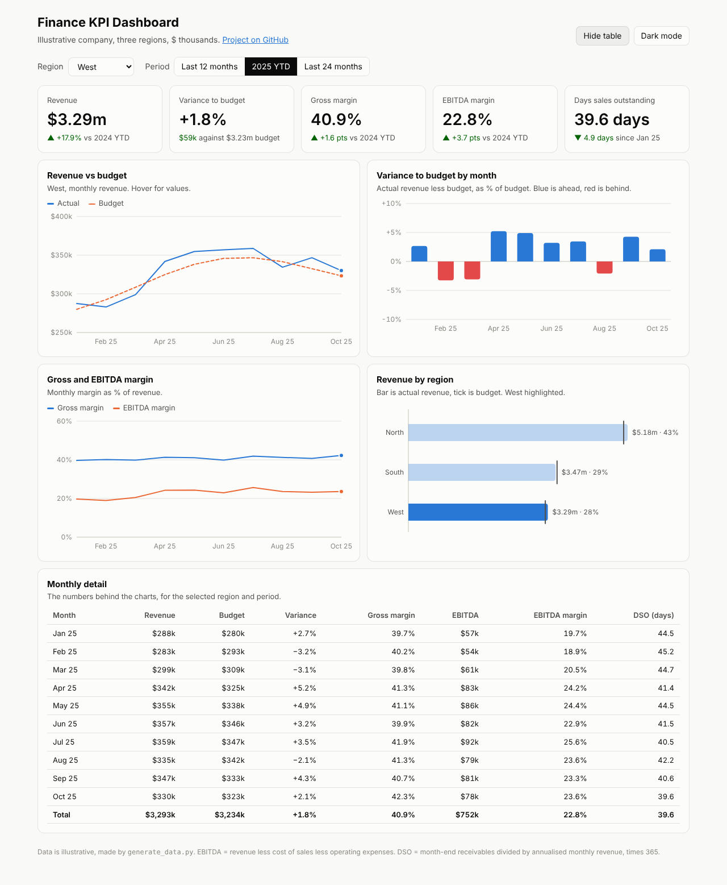

# Finance KPI Dashboard

An interactive dashboard that tracks revenue against budget, gross and EBITDA margin, cash conversion (DSO) and regional performance for an illustrative three-region company.

**▶ Live dashboard: https://muhammedanshajk.github.io/kpi-dashboard/**

**Downloads:** [⬇ Dashboard (HTML)](https://github.com/MuhammedAnshajK/finance-kpi-dashboard/raw/main/dashboard/index.html) · [⬇ Data (CSV)](https://github.com/MuhammedAnshajK/finance-kpi-dashboard/raw/main/data/finance_monthly.csv) · [⬇ Power BI DAX measures](https://github.com/MuhammedAnshajK/finance-kpi-dashboard/raw/main/powerbi/measures.dax) · [⬇ Power BI build steps](https://github.com/MuhammedAnshajK/finance-kpi-dashboard/raw/main/powerbi/BUILD_STEPS.md)

## What this does

The dashboard answers the questions a finance team gets asked every month:

- **Are we on budget?** Revenue for the last 12 months is $13.97m, 0.7% ahead of budget. The monthly variance chart shows the misses (December, January, March and September) and the strong spring.
- **Are margins improving?** Gross margin is 40.6% (up 1.7 points on the prior 12 months) and EBITDA margin is 20.8% (up 3.0 points).
- **Are we collecting cash faster?** DSO fell from 44.4 to 40.4 days over the year.
- **Where does revenue come from?** North is 43% of revenue, South 29% and West 27%. West is the fastest growing region (+17.9% year to date).

Pick a region and a period (last 12 months, 2025 year to date or last 24 months) and every tile, chart and the table update. Hover any chart for exact values. There is a table view and a dark mode.

## Data

24 months (November 2023 to October 2025) of monthly figures for three regions: revenue, budget, cost of sales, operating expenses and receivables, in $ thousands. The data is illustrative and made by `generate_data.py` with a fixed random seed, so it can be recreated exactly. It includes seasonality (a spring and summer peak), steady growth, slowly improving margins and falling DSO, so the dashboard has real trends to show.

## Approach

1. **Data.** `generate_data.py` writes `data/finance_monthly.csv`, one row per month and region.
2. **KPI definitions.** Gross profit = revenue - cost of sales. EBITDA = gross profit - operating expenses. Variance to budget = actual / budget - 1. DSO = month-end receivables / (monthly revenue x 12) x 365, taken at the last month of the period because receivables are a balance, not a flow.
3. **Comparisons.** Each tile compares with the same period a year earlier (prior 12 months, or 2024 year to date). Margin changes are shown in percentage points, not percent.
4. **Dashboard.** `build_dashboard.py` embeds the CSV into `src/template.html` and writes `dashboard/index.html`. It is one file with no external libraries: charts are drawn as SVG with plain JavaScript.
5. **Design choices.** One measure per axis (no dual axes). Blue for actual, orange dashed for budget. Variance bars are blue when ahead and red when behind. The colours were checked for colour-blind readability, and every chart has a legend or direct labels plus a table view.
6. **Power BI version.** The `powerbi/` folder has the same KPIs as DAX measures (including time intelligence such as `SAMEPERIODLASTYEAR` and `TOTALYTD`) and step-by-step instructions to rebuild the report in Power BI Desktop.

## Screenshots

| West, 2025 YTD, with table | Dark mode |
|---|---|
|  |  |

## How to use

- **Online:** open the [live dashboard](https://muhammedanshajk.github.io/kpi-dashboard/).
- **Offline:** download `dashboard/index.html` and double-click it. It works without internet.
- **With your own data:** replace `data/finance_monthly.csv` with the same columns and run `python build_dashboard.py`.
- **In Power BI:** follow [`powerbi/BUILD_STEPS.md`](powerbi/BUILD_STEPS.md).

## Files

- `dashboard/index.html`: the finished dashboard (one self-contained file)
- `src/template.html`: dashboard layout, styles and chart code
- `build_dashboard.py`: embeds the data into the template
- `generate_data.py`: creates the illustrative data
- `data/finance_monthly.csv`: 72 rows (24 months x 3 regions)
- `powerbi/measures.dax`: DAX measures for Power BI
- `powerbi/BUILD_STEPS.md`: how to build the Power BI report
- `images/`: screenshots

## Tools

HTML, CSS, JavaScript (SVG), Python, Power BI (DAX)
