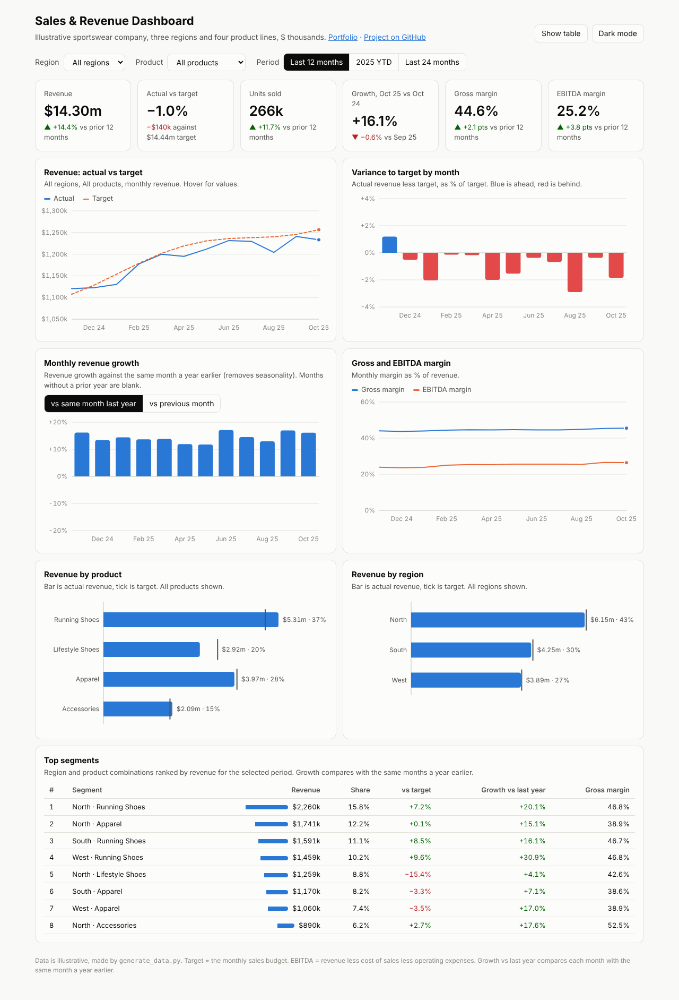
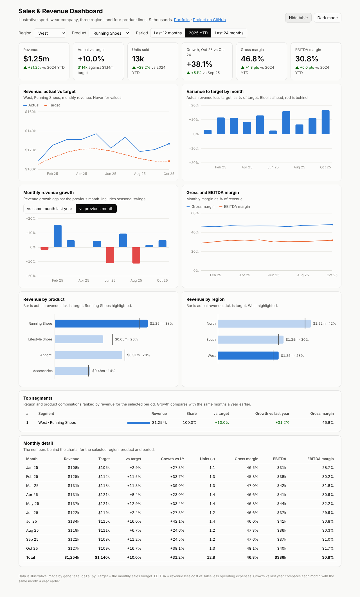
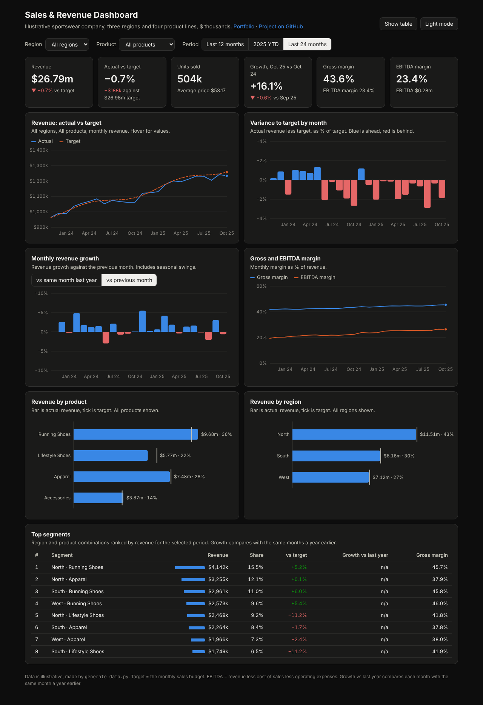

# Sales & Revenue Dashboard

An interactive sales dashboard for an illustrative sportswear company with three regions and four product lines. It shows revenue by product and region, monthly growth, margins, the top-performing segments, and actual against target. A Power BI version with DAX measures is included.

**▶ Live dashboard: https://muhammedanshajk.github.io/kpi-dashboard/**

**Downloads:** [⬇ Dashboard (HTML)](https://github.com/MuhammedAnshajK/finance-kpi-dashboard/raw/main/dashboard/index.html) · [⬇ Data (CSV)](https://github.com/MuhammedAnshajK/finance-kpi-dashboard/raw/main/data/finance_monthly.csv) · [⬇ Power BI DAX measures](https://github.com/MuhammedAnshajK/finance-kpi-dashboard/raw/main/powerbi/measures.dax) · [⬇ Power BI build steps](https://github.com/MuhammedAnshajK/finance-kpi-dashboard/raw/main/powerbi/BUILD_STEPS.md)

## What this does

The dashboard answers the questions a sales and finance team gets asked every month:

- **Are we hitting target?** Revenue for the last 12 months is $14.30m, up 14.4% on the prior 12 months but 1.0% ($140k) short of target.
- **Which products drive it?** Running Shoes are 37% of revenue, grew 21.6% and beat target by 8.2%. Lifestyle Shoes are the problem: flat growth (+2.8%) and 15.6% below target, which explains the whole shortfall.
- **How fast are we growing each month?** October 2025 revenue is up 16.1% on October 2024. A toggle switches the growth chart between "vs same month last year" (removes seasonality) and "vs previous month".
- **Are margins improving?** Gross margin is 44.6% (up 2.1 points) and EBITDA margin 25.2% (up 3.8 points). Accessories have the highest gross margin (52.7%), Apparel the lowest (38.8%).
- **Which segments perform best?** The top segments table ranks every region and product combination. North Running Shoes is the largest; West Running Shoes is the fastest growing (+30.9%).

Pick a region, a product and a period (last 12 months, 2025 year to date or last 24 months) and every tile, chart and table updates. Hover any chart for exact values. There is a monthly table view and a dark mode, and the layout works on a phone.

## Data

24 months (November 2023 to October 2025) of monthly figures by region (North, South, West) and product line (Running Shoes, Lifestyle Shoes, Apparel, Accessories): units, revenue, target (the sales budget), cost of sales, operating expenses and receivables, in $ thousands. The data is illustrative and made by `generate_data.py` with a fixed random seed, so it can be recreated exactly. Each product line has its own growth rate, margin, price and seasonal peak, so the dashboard has real differences to show.

## Approach

1. **Data.** `generate_data.py` writes `data/finance_monthly.csv`, one row per month, region and product (288 rows).
2. **KPI definitions.** Gross profit = revenue - cost of sales. EBITDA = gross profit - operating expenses. Actual vs target = actual / target - 1. Growth vs last year = month / same month a year earlier - 1; growth vs previous month = month / previous month - 1. Average selling price = revenue / units.
3. **Comparisons.** Each tile compares with the same period a year earlier (prior 12 months, or 2024 year to date). Margin changes are shown in percentage points, not percent.
4. **Dashboard.** `build_dashboard.py` embeds the CSV into `src/template.html` and writes `dashboard/index.html`. It is one file with no external libraries: charts are drawn as SVG with plain JavaScript.
5. **Design choices.** One measure per axis (no dual axes). Blue for actual, orange dashed for target, with a tick for target on the product and region bars. Variance and growth bars are blue when positive and red when negative. The colours were checked for colour-blind readability, and every chart has a legend or direct labels plus a table view.
6. **Power BI version.** The `powerbi/` folder has the same KPIs as DAX measures (including time intelligence such as `SAMEPERIODLASTYEAR`, `DATEADD` and `TOTALYTD`, and `RANKX` for top segments) and step-by-step instructions to rebuild the report in Power BI Desktop.

## Screenshots

| West, Running Shoes, 2025 YTD, with table | Dark mode, last 24 months |
|---|---|
|  |  |

## How to use

- **Online:** open the [live dashboard](https://muhammedanshajk.github.io/kpi-dashboard/).
- **Offline:** download `dashboard/index.html` and double-click it. It works without internet.
- **With your own data:** replace `data/finance_monthly.csv` with the same columns and run `python build_dashboard.py`.
- **In Power BI:** follow [`powerbi/BUILD_STEPS.md`](powerbi/BUILD_STEPS.md).

## Files

- `dashboard/index.html`: the finished dashboard (one self-contained file)
- `src/template.html`: dashboard layout, styles and chart code
- `build_dashboard.py`: embeds the data into the template
- `generate_data.py`: creates the illustrative data
- `data/finance_monthly.csv`: 288 rows (24 months x 3 regions x 4 products)
- `powerbi/measures.dax`: DAX measures for Power BI
- `powerbi/BUILD_STEPS.md`: how to build the Power BI report
- `images/`: screenshots

## Tools

HTML, CSS, JavaScript (SVG), Python, Power BI (DAX)
